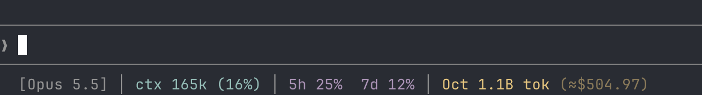

# tallyline

[](https://pypi.org/project/tallyline/)
[](https://github.com/nhinata/tallyline/blob/main/pyproject.toml)
[](https://github.com/nhinata/tallyline/actions/workflows/test.yml)

A fast Claude Code status line that **tallies your token usage and API-equivalent cost by day, month and year** across every session, and tells you **why your usage is high**.



```
Pro/Max plan:  [Opus 5.5] │ ctx 165k (16%) │ 5h 25%  7d 12% │ Oct 1.1B tok (≈$504.97)
API billing:   [Opus 5.5] │ ctx 165k (16%)  6.6M tok (≈$3.85) │ Oct 1.1B tok (≈$504.97)
```

What to watch while working comes first and totals come last: this session (cyan), your whole account (magenta), all sessions on this machine (yellow).

```bash
pipx install tallyline && tallyline init
```

Beyond the status line:

- `tallyline diagnose` shows what drove your usage (cache rewrites after idle breaks, tool outputs kept in context, long context) and what to change.
- `tallyline sessions` lists your open sessions and what resuming each one costs once its cache has expired.

## Why

Claude Code's status line only knows about the current session. tallyline keeps a running ledger of every session on your machine, so you can answer "how much have I used this month?" at a glance.

- **Fast**: after the first scan it parses only newly appended transcript bytes. A render takes about 25 ms.
- **Local only**: it never sends your conversations or usage data anywhere. The only network request is a once-a-day update check against PyPI, which you can turn off.
- **No dependencies**: it uses only the Python standard library (Python 3.9+).
- **Accurate**: it removes duplicate transcript lines written while a response streams. Without that, a naive sum roughly doubles your usage.

## Install

```bash
pipx install tallyline      # or: uv tool install tallyline
tallyline init              # adds the statusLine entry to ~/.claude/settings.json
```

The status line appears without a restart. `init` backs up `settings.json` to `settings.json.bak` and won't replace an existing status line unless you pass `--force`.

## What it shows

| Segment | Scope | Meaning |
|---|---|---|
| `[Opus 5.5]` | — | Current model |
| `ctx 165k (16%)` | this session | Size of the context now, and how full the context window is |
| `6.6M tok (≈$3.85)` | this session | API billing only: tokens used in this session, subagents included |
| `5h 25%  7d 12%` | your account | Pro/Max only: usage of your 5-hour and 7-day rate limits, across all devices and apps |
| `Oct 1.1B tok (≈$504.97)` | all sessions on this machine | Total for the period (`today`, the month, or the year) |

Rate limits update after each response, so usage elsewhere shows up late; treat them as "at least". A `*` after the period, as in `2026*`, means tallyline's records start partway through it (normal right after installing).

Token totals include cache reads, which are cheap, so the `≈$` cost is the better gauge of how heavily you use Claude.

## Finding out why usage is high

`tallyline diagnose` shows what drove your usage and what to change:

```
$ tallyline diagnose
Last 30 days · 9 sessions · 2,087 requests · ≈$331.83 API-equivalent
  cache reads 52%   cache writes 43%   output 6%

Top causes
 1. Resumed after the cache expired                    ≈$122.81   37%
    72 requests after an idle gap wrote the context again (avg 384k tokens).
    → Before a long break, /compact or start a new session.
 2. Tool outputs kept in context                       ≈$102.28   31%
    claude-in-chrome 74% · Read 17% · Bash 6% · Edit 1%
    Costliest: Read notes.md (25.1k tokens, carried 482 turns, ≈$2.52)
    → Delegate broad reading or browsing to a subagent so only its summary stays.
 ...
```

Options: `--days 7` (default 30), `--session <id prefix>`, `--json`, `--no-titles` (hide titles, projects and file names). It reads the transcripts still on disk, so it can't look back past what Claude Code has deleted.

## Finding sessions that are costly to resume

`tallyline sessions` lists every running Claude Code session:

```
$ tallyline sessions
6 open Claude Code sessions · 4 with an expired cache
Resuming all of them writes 612k tokens again (≈$4.90 API-equivalent).

 #  Last message  Where             State  Context  Cache    Resume  Title
 1  now           tmux work:1 api   busy      142k  warm             Add rate limiting to the API
 2  25m ago       tmux work:2 web   idle       64k  warm             Fix login redirect loop
 3  5h ago        ttys004           idle      231k  expired  ≈$1.85  Migrate billing to the new schema
 4  20h ago       tmux work:3 docs  idle      121k  expired  ≈$0.97  Write the release notes
 ...
```

Options: `--sort resume`, `--json`, `--no-titles` (hide titles, directories and tmux window names). It reads `~/.claude/sessions/`, which is undocumented and may change between Claude Code versions.

## Configuration

```bash
tallyline config range month       # today | month | year | all
tallyline config cost off          # hide cost figures
tallyline config color off         # plain text (NO_COLOR is honored too)
tallyline config update-check off  # or set NO_UPDATE_NOTIFIER=1
tallyline config                   # show current settings
```

Settings live in `~/.config/tallyline/config.json`, the cache in `~/.cache/tallyline/usage.db`. `tallyline rebuild` re-scans every transcript and keeps the history of ones Claude Code has deleted.

Prices come from a table bundled with each release, generated from [Anthropic's pricing page](https://platform.claude.com/docs/en/about-claude/pricing). Costs are computed when the status line renders, so a price update also applies to past usage. A model missing from the table shows its cost as `+?`; to fill it in without waiting for a release, add it to `config.json` (USD per million tokens):

```json
{
  "prices": {
    "claude-new-model": {
      "input": 3, "cache_write_5m": 3.75, "cache_write_1h": 6,
      "cache_read": 0.3, "output": 15
    }
  }
}
```

If an entry is invalid, that model's cost shows as `+?`. Fast mode requests are multiplied by the model's `fast_multiplier` (1 if you leave it out).

## Caveats

- The cost is an API-equivalent estimate at list prices, not a bill. On Pro/Max plans you pay your plan price.
- Some background requests are never written to transcripts, so totals can come out lower than `/cost`.
- Claude Code deletes transcripts after `cleanupPeriodDays` (30 by default). tallyline keeps what it has already read, but can't count what was deleted before you installed it.
- Claude Haiku 5.5 prompts over 100,000 tokens are billed at higher prices; tallyline uses the standard prices, so their cost comes out lower.
- Transcripts are an internal Claude Code format and may change.
- If you switch between several Claude accounts on one machine, their rate limit records can mix.
- Tested on macOS and Linux. On Windows only the automated tests run, and `tallyline sessions` may keep listing a crashed session.
- Not affiliated with or endorsed by Anthropic.

## Updating

When a newer release is out, the status line ends with `↑ 0.2.0`. New releases also carry the latest model prices.

```bash
pipx upgrade tallyline      # or: uv tool upgrade tallyline
```

## Uninstall

```bash
tallyline uninstall && pipx uninstall tallyline
```

## Related projects

- [ccusage](https://github.com/ryoppippi/ccusage) builds detailed daily, weekly, monthly and session reports for Claude Code and many other coding agents.
- [ccstatusline](https://github.com/sirmalloc/ccstatusline) offers a highly customizable status line with many widgets and themes.

tallyline keeps to a small, fixed status line plus two questions those tools don't focus on: why usage was high, and which open sessions are costly to resume.

## License

MIT
